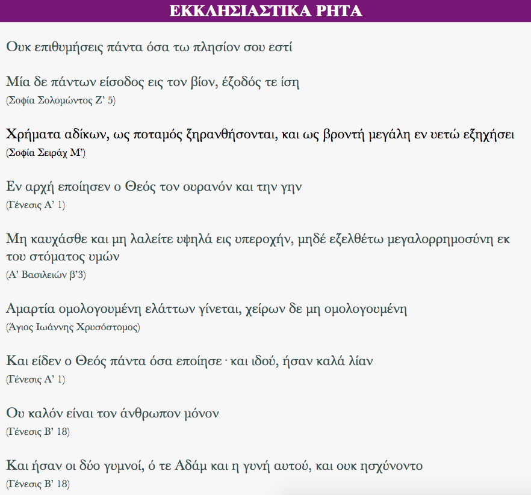

Σύντομα ρητά/αποφθεύγματα αντλούμενα κατά κύριο λόγο από τις παρακάτω πηγές:

· Παλαια Διαθήκη 
· Ευαγγέλια 
· Επιστολές Αποστόλων 
· Καινή Διαθήκη (άλλα) 

Η εφαρμογή δεν απαιτεί σύνδεση στο διαδίκτυο

